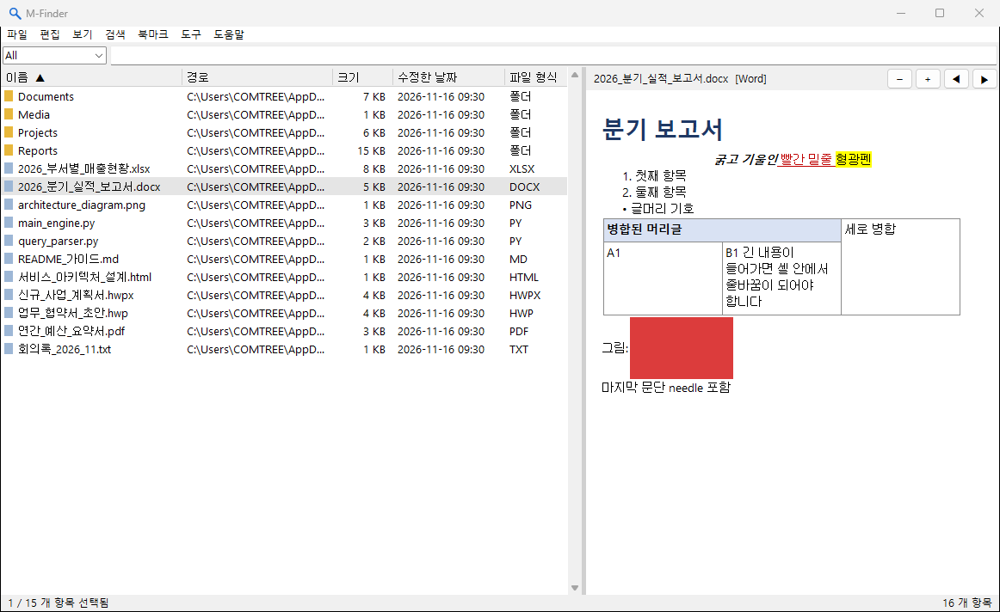
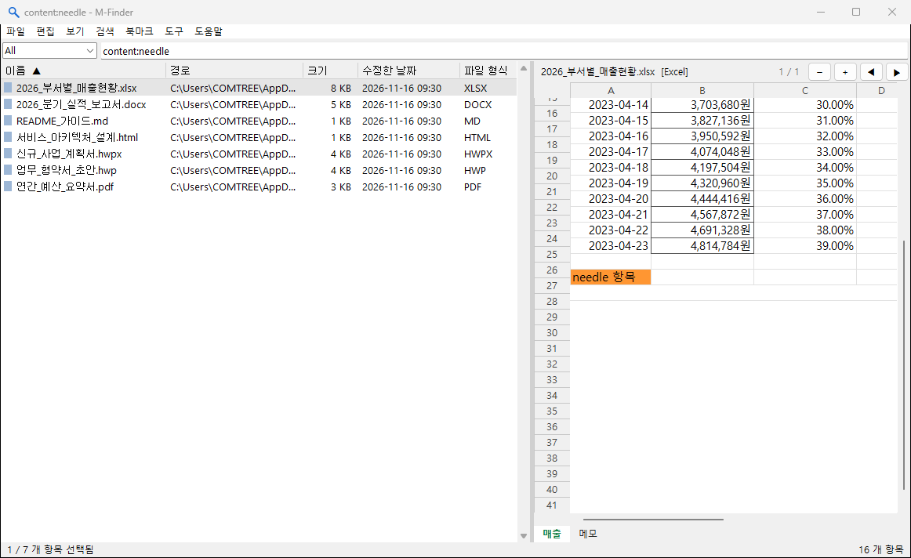
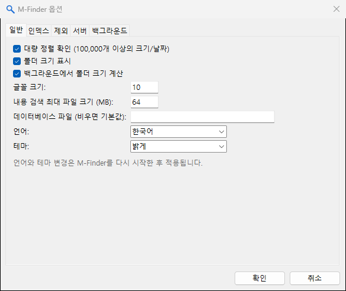

# M-Finder 1.0

**M-Finder**는 Windows용 즉시 파일 이름 검색 및 문서 미리보기 프로그램입니다. NTFS MFT/USN 저널 기반의 초고속 인덱싱과 별도 오피스 프로그램 없이 원본 서식을 재현하는 내장 미리보기 뷰어를 제공합니다.

---

## 주요 화면 및 사용법

### 1. 즉시 파일 검색 & 서식 유지 미리보기 (`F4`)
상단 검색창에 키워드를 입력하면 수백만 개 파일 중 일치 항목이 즉시 표시되며, 우측 미리보기 창(`F4` / `Alt+P`)에서 **HWP, HWPX, DOCX, XLSX, PDF, Markdown, HTML, 이미지, 텍스트**를 바로 확인할 수 있습니다.



### 2. 문서 본문 검색 (`content:`) & 일치 위치 이동
`content:검색어`를 입력하면 일반 텍스트는 물론 **HWP, HWPX, DOCX, XLSX, PPTX, ODF, PDF** 내부 본문까지 검색합니다. 파일을 선택하면 일치 위치가 강조 표시되며 상단 `◀` `▶` 버튼으로 바로 이동할 수 있습니다.



### 3. 환경 설정 (`Ctrl+P`)
테마(시스템/밝게/어둡게), 언어(한국어/English), 인덱싱 대상 드라이브·폴더, 제외 규칙, Windows 서비스 등록, HTTP/ETP 서버, 트레이 및 전역 단축키를 관리합니다.



---

## 핵심 기능

* **초고속 인덱싱 및 실시간 감시**: NTFS MFT / `$MFT` 직접 파싱으로 고속 인덱싱하고, USN 변경 저널과 `ReadDirectoryChangesW`로 파일 변경을 실시간 반영합니다. 백그라운드 폴더 크기 합산도 지원합니다.
* **내장 문서 미리보기**: 한글(`.hwp`, `.hwpx`), Word(`.docx`), Excel(`.xlsx`), PDF(`.pdf`), Markdown(`.md`), HTML(`.html`/`.htm` 페이지·코드 뷰 전환), 이미지(자동 맞춤 및 `Ctrl+휠` 확대/축소)를 지원합니다. 선택 사항으로 [`rhwp`](https://github.com/edwardkim/rhwp) CLI 연동 시 HWP/HWPX 정밀 페이지 조판도 사용할 수 있습니다.
* **부가 기능**: 필터(`All`, 오디오, 문서, 사진 등), 북마크(`Ctrl+D`), 파일 목록(`.efu`/`.csv`/`.txt`) 가져오기·내보내기, 읽기 전용 HTTP/ETP(FTP) 검색 서버를 제공합니다.
* **M-Dir 연동 (IPC)**: 사용자별 명명된 파이프로 실행 중인 인덱스를 다른 프로그램에 제공합니다. `M-Finder.exe gui --headless`로 창 없이 인덱스와 IPC만 띄울 수 있으며(M-Dir가 이 방식으로 실행), IPC `quit` 요청으로 종료됩니다. 지원 요청: `ping`, `status`(`ready`/`rev` 포함), `search`(페이지 단위, 같은 검색어·인덱스이면 정렬된 결과를 재사용), `filters`, `show`, `quit`.

---

## 설치 및 실행

### 단일 실행 파일 (`M-Finder.exe`) — 권장
**`M-Finder.exe` 파일 하나만으로** Python이나 추가 패키지 설치 없이 Windows 10/11 PC에서 바로 실행됩니다. (런타임, UI, 한국어 언어팩, `PyMuPDF`, VC++ 런타임 내장)

```powershell
# 소스에서 단일 실행 파일 빌드 (출력: dist/M-Finder.exe)
pip install pyinstaller pymupdf
python packaging/build_exe.py
```

### Python 소스 실행 (개발 환경)
```powershell
pip install -e .[pdf]   # Python 3.10+ (PDF/이미지 리샘플링 포함; 기본은 pip install -e .)
m-finder                # 또는: python -m mfinder
```

### NTFS MFT 권한 설정 (선택)
MFT/USN 저널 직접 접근에는 관리자 권한 또는 서비스가 필요합니다(미설정 시 일반 폴더 스캔으로 자동 동작).
* **일회성**: 메뉴 **도구 → 관리자 권한으로 다시 시작**
* **상시 사용 (서비스 등록)**: 관리자 권한으로 다시 시작한 뒤 **도구 → 옵션 → 인덱스 → 설치** 클릭 (단독 `.exe`는 자동으로 `C:\Program Files\M-Finder\M-Finder.exe`에 복사되어 등록됨) 또는 관리자 터미널에서 `M-Finder.exe service install` 실행

---

## CLI 및 검색 문법

단독 실행 파일(`M-Finder.exe`)과 설치 명령(`m-finder`) 모두 동일한 CLI 옵션을 지원합니다.

```powershell
M-Finder.exe "ext:py size:>50kb"                  # 검색어를 채워 GUI 열기
M-Finder.exe search -l -n 20 "report ext:docx;pdf" # CLI 검색 (-l 상세, -n 개수)
M-Finder.exe search "content:계약서 ext:hwp;pdf"   # 본문 검색
M-Finder.exe index                                 # 인덱스 수동 재구성
M-Finder.exe serve --port 8080                     # HTTP 검색 서버 실행
M-Finder.exe gui --headless                        # 창 없이 인덱스 + IPC만 실행 (M-Dir용)
```

| 검색 문법 | 설명 | 검색 문법 | 설명 |
|---|---|---|---|
| `a b` / `a \| b` / `!a` | AND / OR / NOT | `ext:hwp;docx;pdf` | 다중 확장자 필터 |
| `<a \| b> ext:png` | 조건 그룹화 | `size:>10mb`, `size:1mb..50mb` | 크기 범위 (`tiny`~`gigantic` 지원) |
| `"정확한 문구"` | 공백 포함 일치 | `dm:today`, `dm:2026-11` | 수정(`dm:`), 생성(`dc:`), 액세스(`da:`) 날짜 |
| `*.txt`, `c:\docs\*` | 와일드카드 (`\` 시 경로 포함) | `content:"검색어"` | 파일 본문 텍스트 검색 |
| `file:`, `folder:`, `empty:` | 파일 / 폴더 / 빈 폴더 | `pic:`, `doc:`, `audio:`, `video:` | 파일 종류 매크로 |

---

## 주요 단축키

| 단축키 | 동작 | 단축키 | 동작 |
|---|---|---|---|
| `Ctrl+F` / `Ctrl+L` / `F3` | 검색창 포커스 | `F4` / `Alt+P` | 미리보기 창 토글 |
| `Enter` / `더블 클릭` | 선택한 항목 열기 | `Ctrl+Shift+C` | 전체 경로 복사 |
| `Delete` | 휴지통으로 삭제 | `Ctrl+D` | 북마크 추가 |
| `Ctrl+I` / `Ctrl+B` | 대소문자 / 단어 단위 일치 | `Ctrl+U` / `Ctrl+R` | 전체 경로 / 정규식 토글 |
| `Ctrl+P` / `F5` | 옵션 / 인덱스 다시 만들기 | `Ctrl++` / `Ctrl+-` / `Ctrl+0` | 확대 / 축소 / 초기화 |

---

## 데이터 위치 및 보안

* **설정·인덱스 저장 경로**: `%APPDATA%\M-Finder\` (`settings.json`, `fileindex.db`)
* **보안**: IPC 명명된 파이프는 현재 사용자 SID ACL로 제한되며, HTTP/ETP 서버는 기본 비활성화(활성화 시 `127.0.0.1` 바인딩)입니다.

```powershell
# 테스트 실행
python -m unittest discover -s tests                         # 기본 테스트
$env:MF_GUI_TEST = 1; python -m unittest discover -s tests   # + Tk GUI 스모크 테스트
```
